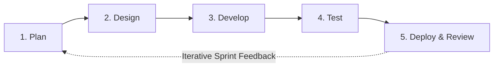

# Project Documentation: Smart Web-Based Queuing Management System with Mobile Tracking and Statistical Reporting for the BPL-LIEO of LGU, Rosario, La Union

**Project Title:** Design and Implementation of a Smart Web-Based Queuing Management System with Mobile Tracking and Statistical Reporting for the BPL-LIEO of LGU, Rosario, La Union  
**Proponents:** Rojean F. Tandas, Manrijan M. Barbosa, Carren Nicole A. Estrelles, John David R. Garcia, Jade Allysa V. Rulloda  
**Institution:** Don Mariano Marcos Memorial State University – South La Union Campus (DMMMSU-SLUC), College of Computer Science  
**Beneficiary / Client:** Business Permits, Licensing - Local Investment and Enterprise Office (BPL-LIEO), LGU Rosario, La Union  
**Adviser:** Prof. Emely A. Munar, MIT  

---

## 1. Project Overview

The **Smart Web-Based Queuing Management System with Mobile Tracking and Statistical Reporting** is an intelligent, hybrid local-and-cloud web application designed for the **Business Permits, Licensing - Local Investment and Enterprise Office (BPL-LIEO)** of the Local Government Unit (LGU) of Rosario, La Union.

### 1.1 Background and Problem Context
During peak business registration and permit renewal periods, the BPL-LIEO accommodates a massive daily influx of transacting citizens and business representatives across distinct transaction types (**New Business Application**, **Business Permit Renewal**, and **Business Retirement/Closure**). Relying on manual or purely localized queuing methods leads to overcrowded waiting areas, uncertain waiting times, disorganized client flow, and heavy operational pressure on frontline staff who must manually balance different transaction categories and priority groups.

Furthermore, while the Anti-Red Tape Authority (ARTA) mandates the electronic Business One-Stop Shop (eBOSS) to streamline permit filing and payment, eBOSS primarily addresses the transaction record process rather than the physical waiting experience and client flow inside the municipal hall. At the BPL-LIEO of Rosario, La Union, clients frequently step away from the waiting area, leading to missed calls ("no-shows"), skipped numbers, and "return-tomorrow" (postponed) transactions.

### 1.2 Proposed Solution
To bridge this operational gap, the project introduces a communicative, adaptive queuing solution that eliminates the physical confines of the waiting room and automates queue and counter orchestration. The system integrates five core capabilities:
1. **QR-Code Ticket Generation:** Issues unique, date-and-category-prefixed queue tickets (e.g., `NW-MMDDYY-001`, `RNW-MMDDYY-001`, `R-MMDDYY-001`) tailored to the client's transaction type and priority classification, embedded with a scannable QR code.
2. **Mobile Queue Tracking & Multi-Channel Alerts:** Enables clients to monitor their live queue rank and estimated waiting time from their smartphones via QR scan, complemented by automated real-time **SMS (via Vonage)** and **Web Push** notifications when they are within 2 spots of being called, upon initial call, and on counter recall.
3. **Smart Auto-Balancing & Priority Engine:** Replaces rigid First-In-First-Out (FIFO) queuing with:
   - A dynamic **Smart Score ($S(t)$)** ticket-ranking engine that balances Priority groups (*Senior Citizens, PWDs, Pregnant Women, Returning Clients*) and *Regular* clients using passive aging, SLA Panic Bonuses, Stoplight Skip Limits, and a Zipper Force starvation-prevention rule.
   - A **Proportional Counter Auto-Balancing Engine** that dynamically shifts staff counter allocations between **Peace Mode** (all windows cater to all services) and **Crunch Mode** (proportional "Robin Hood" window allocation with hysteresis deadband and SLA starvation floor override).
   - A **Phantom Queue Simulation ($E[W]$)** model that predicts client waiting time using true simulated rank, human abandonment discounting, active counter capacity, and rolling average service time.
4. **Staff-Controlled Dashboard & Public Monitor Display:** Provides authorized personnel with real-time queue controls (*Call Next / Auto-Assign*, *Recall*, *Skip / Defer*, *Postpone / Return Tomorrow*, *Mark No-Show*, *Complete / Done*) synchronized instantaneously with a public Smart TV monitor display featuring voice call synthesis, audio chimes, and a customizable scrolling ticker.
5. **Statistical Reporting & SLA Analytics:** Captures transaction logs and audit trails to generate comprehensive analytics on daily/historical client volume, Year-over-Year (YoY) changes, Service Level Agreement (SLA) adherence, busiest hours/days, drop-off rates, counter utilization, and individual staff performance metrics.

---

## 2. Project Scope

### 2.1 Scope of the System (In-Scope)
The project encompasses the design, development, alpha/beta testing, hybrid deployment, and ISO/IEC 25010 quality evaluation of the Smart Web-Based Queuing Management System for the BPL-LIEO of Rosario, La Union during the School Year 2026–2027.

#### A. Core System Modules
1. **Ticket Generator Module**
   - Selection of **Transaction Type / Service**:
     - *New Business Application* (`NW`)
     - *Business Permit Renewal* (`RNW`)
     - *Business Retirement / Closure* (`R`)
   - Selection of **Priority Classification**: *Regular*, *Person with Disability (PWD)*, *Senior Citizen*, *Pregnant Woman*, or *Returning Client* (with administrator support for configuring custom priority groups and weights).
   - Atomic daily sequence generation (`<PREFIX>-<MMDDYY>-<SEQ>`) preventing duplicate ticket numbers under concurrent requests.
   - Automated thermal/ink printing of a physical queue ticket with customizable header/footer text, predicted wait time display, and a **Scannable QR Code** linked to the mobile tracker.

2. **Smart Queue Engine & Staff-Controlled Dashboard**
   - Role-based access control (**STAFF** vs. **ADMIN**) and real-time multi-tab staff online presence tracking.
   - Staff queue operations: **Auto-Assign / Call Next**, **Recall** (with database-lock protection and reminder notifications), **Complete (`COMPLETED` / Done)**, **Defer / Postpone (`POSTPONED` / Return Tomorrow)**, and **Mark Absent (`NO_SHOW`)**.
   - **Adaptive Ticket Scoring ($S(t)$):** Real-time sorting based on base priority weight ($P_{\text{base}}$), elapsed wait-time aging ($W_{\text{mins}} \times R_{\text{aging}}$), SLA Panic Bonus ($P_{\text{SLA}} = +100$), Stoplight Skip Limit Bonus ($P_{\text{skip}} = +500$), and Zipper Force Bonus ($P_{\text{zipper}} = +1000$).
   - **Dynamic Counter Auto-Balancing (Peace & Crunch Modes):** Automatically reallocates auto-assignable counter staff across transaction queues every 5 minutes (or on-demand via 3-second debounced triggers) based on weighted service load and SLA starvation thresholds, while guaranteeing minimum staff coverage per active service.
   - **Predictive Wait Time via Phantom Simulation ($E[W]$):** Injects a virtual phantom ticket to determine true rank ($R_{\text{true}}$), applies a tiered Abandonment Discount ($D$, $5\%$ per $10$ clients ahead up to $30\%$), and computes expected wait time across active service counters ($C$) and dynamic rolling average service time ($T_{\text{avg}}$).

3. **Real-Time Public Monitor Display Module**
   - Public-facing Smart TV/monitor view broadcasting currently served tickets per **Service Window**, upcoming waiting tickets sorted by Smart Score, and live estimated wait times per service.
   - Integrated **Voice Call Announcement** (text-to-speech), **Audio Chime** alerts on initial call and recall, and configurable **Scrolling Ticker Text** for citizen advisories.

4. **Mobile Client Tracker & Multi-Channel Notification Module**
   - Cloud-synchronized mobile web tracker accessed by scanning the ticket QR code, displaying live ticket status, true queue rank, assigned counter window, and dynamic estimated wait time.
   - Self-service client opt-in for **SMS alerts** (via Vonage Server SDK, including a welcome confirmation SMS) and browser **Web Push notifications** (VAPID-authenticated).
   - Automated dispatch of approaching-turn alerts (when true rank $\le 2$) and immediate call/recall notifications directing the client to their assigned counter.

5. **Administrator Statistical Reporting, Settings & Audit Module**
   - Interactive analytics dashboard (powered by Recharts) tracking:
     - **Office Volume & Trends:** Daily, monthly, and yearly transaction counts broken down by New Application, Renewal, and Retirement, with **Year-over-Year (YoY)** percentage comparisons and sparklines.
     - **SLA & Time Metrics:** SLA adherence percentage, average wait time (minutes), average service duration (minutes), and live last-hour client flow.
     - **Operational Insights:** Busiest hours of the day, busiest days of the week, priority demographic breakdown, average skip count, and drop-off counts (*No-Show* and *Postponed / Return Tomorrow*).
     - **Staff & Counter Performance:** Per-employee and per-counter transaction counts (yearly and all-time) and counter catering assignments.
   - Paginated, filterable **Queue History** and tamper-evident **Queue Audit Logs** (`QueueAudit`) recording every ticket status transition, actor, and window number.
   - System configuration panel for customizing office branding, SLA thresholds, zipper ratios, aging rates, skip limits, and automated daily local database backups.

#### B. Target Users and Evaluation Respondents
- **BPL-LIEO Frontline Staff & Administrators ($N = 10$, Total Enumeration):** Operate the ticket generator, counter dashboard, system settings, and statistical reporting module.
- **Visiting Citizens / Clients ($n = 50$, Convenience Sampling from $N = 150$):** Receive printed QR tickets, view the public monitor, and use mobile tracking and SMS/Web Push notifications.
- **IT Experts / System Evaluators ($n = 2$, Purposive Sampling):** Assess technical implementation, particularly security, maintainability, portability, and compatibility.

### 2.2 Limitations and Delimitations (Out-of-Scope)
- **Focus on Queue Orchestration vs. eBOSS Document Processing:** The system manages physical and virtual client queuing, counter allocation, real-time notifications, and queue analytics; it does **not** perform tax assessment, regulatory document verification, or online fee collection (which belong to the eBOSS platform).
- **LGU-Specific Workflow Configuration:** Transaction categories, counter structures, and SLA parameters are tailored specifically to the operational workflow of the **BPL-LIEO of LGU Rosario, La Union**.
- **External Network & Carrier Dependencies:** SMS delivery relies on third-party cellular carrier availability via the Vonage API, and remote mobile tracking relies on internet connectivity to synchronize with Firebase/Firestore (while local counter and monitor operations continue seamlessly over the local area network via SQLite).

---

## 3. Software Development Methodology

The study adopts the **Agile Software Development Life Cycle (SDLC)** model (cited in Nordin et al., 2025; Milne, 2021; LTS Group, 2023). In Agile development, the system is constructed incrementally through iterative cycles (*sprints*), enabling the researchers to adapt to evolving BPL-LIEO workflow requirements, continuously integrate staff feedback, and rigorously test real-time WebSocket and cloud synchronization.

### Phases of the Agile Methodology

#### 1. Plan
- **Purpose:** Identify stakeholder needs, define project scope and objectives, translate requirements into prioritized features, and estimate sprint workloads (Nordin et al., 2025).
- **Execution in the Study:**
   - Conducted formal interviews (Appendix B) and observational workflow analysis with the BPL-LIEO Officer-in-Charge and staff.
   - Identified key operational bottlenecks: peak-season crowding, manual balancing of New vs. Renewal vs. Retirement transactions, absent clients when called ("no-shows"), and handling of "Return Tomorrow" clients.
   - Defined core functional requirements: QR-based ticket issuance, live counter calling, priority and returning-client management, adaptive auto-balancing ($S(t)$ and counter allocation), Phantom Queue wait-time estimation ($E[W]$), multi-channel notifications (SMS and Web Push), and SLA statistical reporting.

#### 2. Design
- **Purpose:** Collaboratively design the software architecture, database schemas, network routing, and UI/UX wireframes (Milne, 2021).
- **Execution in the Study:**
  - **Data Flow Diagrams (DFD Levels 0 & 1):** Mapped hybrid information routing between the local SQLite database, LAN Socket.io broadcasters, Firebase/Firestore cloud sync, Vonage SMS gateway, and mobile clients (*Figures 1 and 2*).
  - **Entity-Relationship Diagram (ERD):** Modeled relational schemas (`User`, `Service`, `Counter`, `Ticket`, `TicketCounter`, `PriorityGroup`, `Settings`, `QueueAudit`) managed via Prisma ORM (*Figure 3*).
  - **UML Use-Case Diagram:** Defined actor-role boundaries and system interactions for *Client / Citizen*, *BPL-LIEO Frontline Staff*, *BPL-LIEO Administrator*, and the *Vonage SMS Gateway* (*Figure 4*).
  - **UML Swimlane Activity Diagram:** Modeled the end-to-end algorithmic control flow across actors, including Smart Score ($S(t)$) sorting, Phantom Queue ($E[W]$) calculation, and counter auto-balancing (*Figure 5*).
  - **Business Process Model and Notation (BPMN 2.0):** Modeled cross-organizational message flows, timer events, and exception handling across the Client, BPL-LIEO System, and Vonage SMS Gateway pools (*Figure 6*).
  - **Interactive Wireframes:** Designed responsive layouts for the Ticket Generator, Staff Dashboard, Public TV Monitor Display, Admin Analytics Panel, and Mobile Client Tracker.

#### 3. Develop
- **Purpose:** Construct the software increments in accordance with the architectural designs (Milne, 2021).
- **Execution in the Study:**
  - Built the frontend single-page application using **React.js (Vite)**, **Tailwind CSS**, **Framer Motion**, **Recharts**, **Lucide React**, **React Query**, and **QR Code React**.
  - Engineered the backend RESTful API using **Node.js**, **Express.js**, and **TypeScript**, secured with **JWT**, **bcrypt**, **Helmet**, **express-rate-limit**, and **Zod** schema validation, and documented via **Swagger UI**.
  - Implemented local relational persistence using **Prisma ORM** with **SQLite (WAL mode)** alongside non-blocking real-time cloud synchronization via **Firebase Admin / Cloud Firestore** (including automated catch-up sync on server startup and scheduled cron database backups).
  - Implemented the **Smart Queue Engine**, **Socket.io** real-time event broadcasting, **Vonage Server SDK** SMS integration, and **Web Push** notifications.

#### 4. Test
- **Purpose:** Evaluate system accuracy, stability, and compatibility through continuous unit, integration, stress, alpha, and beta testing (Nordin et al., 2025; LTS Group, 2023).
- **Execution & Required Testing Outputs (Specific Objective 2):**
  - Conducted automated unit and API integration testing (using **Jest**, **Supertest**, and **Vitest**) on endpoints, Smart Queue math formulas, WebSocket emitters, and cloud sync triggers, plus stress testing under simulated concurrent client loads.
  - Executed **Alpha Testing** in a simulated lab environment with peer developers and **Beta Testing** with actual BPL-LIEO personnel across both LAN and live web environments.
  - **Four Formal Testing Deliverables:**
    1. **Summary of Alpha and Beta Testing Results:** A Pass/Fail Matrix evaluating core modules (QR Code Scanning, Ticket Generation, Smart Auto-Balancing, SMS/Push Notification Delivery, Real-Time TV Display Update), comparing expected vs. actual outputs and logging defects for sprint resolution.
    2. **Defect Resolution and System Improvements Report:** A narrative log detailing technical issues encountered during Alpha/Beta testing and the code optimizations applied.
    3. **Real-Time Cloud & Local Synchronization Performance:** Latency measurement (in milliseconds) between a staff member clicking *"Call Next"* and the public TV display updating via WebSockets, paired with cross-reference queries between local SQLite and Firebase Cloud to verify **$0\%$ data loss** during internet interruptions.
    4. **Predictive Wait Time Accuracy Analysis:** Statistical evaluation of the Phantom Queue Simulation algorithm using **Mean Absolute Error (MAE)**, comparing the recorded *Predicted Wait Time* against the *Actual Wait Time* upon transaction completion.

#### 5. Deploy and Review
- **Purpose:** Deliver the working software into the operational environment and evaluate its quality with end-users (LTS Group, 2023).
- **Execution in the Study:**
  - Deployed the system in a hybrid cloud-hosted and local LAN environment at the BPL-LIEO of LGU Rosario, La Union.
  - Conducted live trial runs and administered the **ISO/IEC 25010 Software Quality Model** evaluation questionnaire (adapted from Cando & Gerardo, 2020; Appendix C) to $62$ respondents ($10$ BPL-LIEO Staff, $50$ Citizens/Clients, and $2$ IT Experts).
  - Analyzed responses using the **5-point Likert Scale Weighted Mean** ($4.20\text{–}5.00$ *Excellent*, $3.40\text{–}4.19$ *Very Good*, $2.60\text{–}3.39$ *Good*, $1.80\text{–}2.59$ *Fair*, $1.00\text{–}1.79$ *Poor*).

---

## 4. Software Requirements

### 4.1 Mathematical Queuing Model & Algorithmic Specifications
To prevent priority queue starvation while honoring statutory priority mandates, the system implements two core mathematical models in its Smart Queue Engine:

#### 1. Adaptive Auto-Balancing Formula (Smart Score $S(t)$)
Every waiting ticket $t$ is continuously scored and sorted in descending order (with ties broken by earliest arrival timestamp):
$$S(t) = P_{\text{base}} + (W_{\text{mins}} \times R_{\text{aging}}) + P_{\text{SLA}} + P_{\text{skip}} + P_{\text{zipper}}$$
- $P_{\text{base}}$: Base demographic priority weight assigned to the client's group (e.g., Regular $= 0$, elevated weights for PWD, Senior Citizen, Pregnant, Returning).
- $W_{\text{mins}}$: Elapsed waiting time in minutes since ticket generation.
- $R_{\text{aging}}$: Configurable passive aging rate (default $0.1\text{ pts/min}$) allowing Regular tickets to gain priority over time.
- $P_{\text{SLA}}$: **SLA Panic Bonus ($+100\text{ points}$)** applied when $W_{\text{mins}}$ reaches or exceeds the acceptable SLA wait-time threshold (default $15\text{ mins}$).
- $P_{\text{skip}}$: **Stoplight Skip Limit Bonus ($+500\text{ points}$)** applied when a waiting ticket has been bypassed/skipped at least the maximum allowable number of times (default $5$ skips).
- $P_{\text{zipper}}$: **Zipper Force Bonus ($+1000\text{ points}$)** applied to the oldest waiting *Regular* ticket in a service queue when the last $N$ consecutive served clients (default $N = 3$) were exclusively priority clients.

#### 2. Predictive Wait Time with Phantom Simulation ($E[W]$)
When estimating wait times for a new or waiting ticket, the system injects a virtual phantom ticket into the live queue to determine its true rank $R_{\text{true}}$ under $S(t)$, applies a human **Abandonment Discount ($D$)** of $5\%$ per $10$ clients ahead (capped at $30\%$):
$$D = \min\left(0.30, \left\lfloor \frac{R_{\text{true}} - 1}{10} \right\rfloor \times 0.05\right)$$
and computes the **Expected Wait Time ($E[W]$)** in minutes across actively manned counters $C$ and rolling average service time $T_{\text{avg}}$:
$$E[W] = \max\left(1, \text{round}\left(\frac{R_{\text{true}} \times (1 - D)}{C} \times T_{\text{avg}}\right)\right)$$

---

### 4.2 Functional Requirements

| Req. ID | Module | Functional Requirement Description |
| :--- | :--- | :--- |
| **FR-1.1** | **Ticket Generator** | The system shall allow selection of Transaction Type (*New Application, Renewal, Retirement*) and Priority Classification (*Regular, PWD, Senior Citizen, Pregnant, Returning*). |
| **FR-1.2** | **Ticket Generator** | The system shall atomically generate a unique daily ticket number (`<PREFIX>-<MMDDYY>-<SEQ>`), compute its initial predictive wait time $E[W]$, and print a physical ticket with a scannable QR code. |
| **FR-2.1** | **Smart Queue Engine** | The system shall continuously rank waiting tickets using the Smart Score formula $S(t)$ and re-sort the queue upon every ticket creation, call, skip, or status change. |
| **FR-2.2** | **Smart Queue Engine** | The system shall automatically balance counter catering assignments between *Peace Mode* (all services) and *Crunch Mode* (proportional load allocation with SLA starvation override and minimum coverage guarantee). |
| **FR-2.3** | **Staff Dashboard** | The system shall allow authenticated counter staff to *Auto-Assign/Call Next*, *Recall*, *Complete (Done)*, *Postpone (Return Tomorrow)*, and *Mark No-Show*, enforcing counter service allocation rules. |
| **FR-3.1** | **Public Monitor Display** | The system shall display currently served tickets per window, next waiting tickets, live estimated wait times, scrolling advisories, audio chimes, and voice call announcements in real time. |
| **FR-4.1** | **Mobile Tracking** | The system shall provide a cloud-synced mobile web interface via QR scan displaying real-time ticket status, true queue rank ($R_{\text{true}}$), assigned counter, and updated wait time ($E[W]$). |
| **FR-4.2** | **Multi-Channel Notifications** | The system shall allow clients to subscribe via mobile number (SMS via Vonage) or browser (Web Push) and automatically alert them when they are $\le 2$ spots away, when called, and when recalled. |
| **FR-5.1** | **Statistical Reporting & Audit** | The system shall generate administrative reports on daily/yearly volume, YoY trends, SLA adherence, average wait/service times, busiest hours/days, drop-offs, staff performance, and immutable audit logs. |

---

### 4.3 Non-Functional Requirements (ISO/IEC 25010 Software Quality Standards)
The system is designed and evaluated against all **eight (8)** quality characteristics of the **ISO/IEC 25010 Software Quality Model**:

1. **Functionality** (*Completeness, Correctness, Appropriateness*): Accurately executes ticket generation, mathematical priority scoring, counter auto-balancing, multi-channel notifications, and statistical reporting.
2. **Reliability** (*Maturity, Availability, Fault Tolerance, Recoverability*): Operates on a hybrid local SQLite (WAL mode) and Firebase Cloud architecture that guarantees $0\%$ data loss during internet dropouts, automatic startup catch-up synchronization, and scheduled automated local database backups.
3. **Usability** (*Appropriateness Recognizability, Learnability, Operability, User Error Protection, UI Aesthetics, Accessibility*): Provides clean, responsive interfaces with clear visual hierarchy, audio/voice accessibility on public monitors, and input validation.
4. **Efficiency** (*Time Behavior, Resource Utilization, Capacity*): Achieves millisecond-level WebSocket event broadcasting over LAN and parallelized database aggregation queries for instant analytics rendering under concurrent load.
5. **Maintainability** (*Modularity, Reusability, Analyzability, Modifiability, Testability*): Uses a decoupled MVC/service architecture with Prisma ORM schemas, Express controllers, Swagger API docs, and automated Jest/Vitest test suites.
6. **Portability** (*Adaptability, Installability, Replaceability*): Runs across desktop browsers, Smart TVs, and mobile smartphones (Android/iOS) without requiring native app installation.
7. **Compatibility** (*Co-existence, Interoperability*): Seamlessly integrates local REST/WebSocket services with Firebase Cloud Firestore, Web Push (VAPID) protocols, and the Vonage SMS REST API.
8. **Security** (*Confidentiality, Integrity, Non-Repudiation, Accountability, Authenticity*): Implements JWT authentication, `bcrypt` password hashing, Role-Based Access Control (Admin vs. Staff), `Helmet` security headers, API rate limiting (`express-rate-limit`), strict `Zod` payload validation, and `QueueAudit` non-repudiation logs.

---

### 4.4 Technical Software Requirements (Development & Runtime Stack)

| Layer / Category | Software / Technology | Purpose & Role in the System |
| :--- | :--- | :--- |
| **Frontend UI & State Management** | **React.js 18 (powered by Vite 5)** | Component-based frontend UI library and fast bundler for Kiosk, Staff Dashboard, Public TV Display, Mobile Tracker, and Admin Panel. |
| | **React Router DOM v6** | Declarative client-side routing across public, staff, and administrative views. |
| | **Tailwind CSS v4** | Utility-first CSS framework for responsive layout styling and dark/light visual themes. |
| | **Framer Motion** | Declarative animation library for smooth queue card transitions and visual call alerts. |
| | **Recharts** | Composable charting library for rendering SLA trends, hourly/daily bar charts, and YoY analytics. |
| | **Lucide React** | Consistent vector iconography across all user interfaces. |
| | **React Query (TanStack Query v5)** | Server-state caching, background synchronization, and API mutation management. |
| | **QR Code React (`qrcode.react`)** | Dynamic generation of scannable QR codes on tickets linking to the mobile tracker. |
| **Backend & Security** | **Node.js, Express.js & TypeScript (`tsx`)** | Backend runtime and RESTful API server executing business logic and queue algorithms. |
| | **JSON Web Tokens (`jsonwebtoken`)** | Stateless session authentication and Role-Based Access Control (RBAC). |
| | **bcrypt (`bcryptjs`)** | Cryptographic password hashing for staff and administrator credentials. |
| | **Zod** | Strict runtime schema validation for API request payloads and push subscriptions. |
| | **Helmet & Express Rate Limit** | HTTP response header hardening and API rate limiting against brute-force/DoS attacks. |
| | **Pino & Node-Cron** | High-performance structured logging and scheduled automated database backups. |
| | **Swagger UI (`swagger-ui-express`)** | Interactive OpenAPI/Swagger documentation (`/api-docs`) for REST endpoints. |
| **Database & Cloud Synchronization** | **Prisma ORM v5** | Type-safe Object-Relational Mapper managing schema migrations and relational queries. |
| | **SQLite (WAL Mode) / PostgreSQL** | Primary local relational database storing tickets, users, counters, settings, and audit logs. |
| | **Firebase Admin & Cloud Firestore** | Cloud NoSQL database powering real-time synchronization for remote mobile ticket tracking. |
| **Real-Time Communication & Alerts** | **Socket.io (`socket.io` & `socket.io-client`)** | Bidirectional WebSocket engine for instant LAN/web broadcasting of queue calls, status updates, and staff online presence. |
| | **Vonage Server SDK (`@vonage/server-sdk`)** | Telecommunications gateway for sending automated SMS notifications to clients. |
| | **Web Push (`web-push`)** | VAPID-based browser push notification service for mobile client turn alerts. |
| **Development, Testing & Process Tools** | **Visual Studio Code (VS Code) & Git** | Primary IDE and distributed version control system for collaborative Agile development. |
| | **Jest, Supertest & Vitest** | Automated unit and integration testing frameworks for backend APIs, Smart Queue math, and frontend components. |
| | **PM2** | Production process manager for Node.js server uptime and automatic restart. |
| | **Modern Web Browsers** | Google Chrome, Microsoft Edge, and Apple Safari for desktop, Smart TV, and mobile execution. |

---

### 4.5 Hardware Requirements
- **Laptops / Desktop Computers:** For software development and for BPL-LIEO frontline staff and administrators to operate the Ticket Generator, Staff Dashboard, and Statistical Reporting interfaces.
- **Standard Thermal / Ink Printer:** Connected to the ticket generator terminal for printing physical queue tickets with scannable QR codes.
- **Smart TV or Large Monitor Display:** Installed in the BPL-LIEO waiting area with audio output support (for chimes and voice call announcements) to display live queue updates.
- **Internet-Connected Routers / LAN Infrastructure:** Network hardware providing local area network (LAN) connectivity for low-latency Socket.io broadcasting and internet access for Firebase Cloud synchronization and Vonage SMS dispatch.

---

## 5. System Architecture and Design Models

This section presents the architectural, data, behavioral, and business process models designed during the **Design Phase** of the Agile SDLC. All editable source files are maintained in the `Thesis Documents` directory and strictly balanced across levels.

---

### 5.1 Data Flow Diagrams (DFD Level 0 and Level 1)

The **Data Flow Diagrams** (source: [BPL-LIEO_DFD_Level_0_and_1.drawio](file:///c:/Users/jdxrg/OneDrive/BSCS%20(4th)%20-%201st%20Sem/Thesis%20Research%201/BPL-LIEO%20Queuing%20System/Thesis%20Documents/BPL-LIEO_DFD_Level_0_and_1.drawio)) illustrate how information enters, transforms, and exits the system across external entities, internal functional processes, and hybrid local/cloud data stores.

#### 1. Context-Level Data Flow Diagram (DFD Level 0)
**DFD Level 0** depicts the entire application as a single unified process (**Process 0: Smart Web-Based Queuing Management System**) exchanging data flows with four external entities:
- **Client / Citizen:** Submits *Service Selection & Priority Flag* and *QR Scan & SMS/Push Opt-In*; receives *Printed Thermal Ticket (w/ QR)*, *Mobile Tracker View & Web Push Alert*, and *SMS Notification (Turn Approaching / Called)*.
- **BPL-LIEO Frontline Staff:** Submits *Counter Commands (Call Next, Recall, Hold, Complete)*; receives *Active Queue List & Citizen Status*.
- **BPL-LIEO Administrator:** Submits *System Config, Staff Accounts & Report Filters*; receives *KPI Dashboard & Exported Reports (PDF/CSV)*.
- **Vonage SMS Gateway:** Receives *SMS Payload (Phone No., Message)*; returns *SMS Delivery Status*.

> **[INSERT IMAGE IN WORD HERE: Export Tab 1 (`DFD Level 0 (Context)`) of [BPL-LIEO_DFD_Level_0_and_1.drawio](file:///c:/Users/jdxrg/OneDrive/BSCS%20(4th)%20-%201st%20Sem/Thesis%20Research%201/BPL-LIEO%20Queuing%20System/Thesis%20Documents/BPL-LIEO_DFD_Level_0_and_1.drawio) at 300% Zoom PNG]**
>
> **Figure 1.** *Context-Level Data Flow Diagram (DFD Level 0) of the BPL-LIEO Smart Queuing Management System.*

#### 2. Level 1 Data Flow Diagram (DFD Level 1)
**DFD Level 1** decomposes Process 0 into five core functional processes (**1.0 to 5.0**) and four persistent data stores (**D1 to D4**), maintaining strict 1-to-1 external flow balancing with Level 0:
1. **Process 1.0 – Generate Queue Ticket & QR Code:** Accepts citizen transaction/priority inputs, reads/updates daily sequences in **D1: Tickets & Daily Sequence Store (SQLite)**, and issues the printed QR ticket.
2. **Process 2.0 – Compute Smart Score $S(t)$, Predict Wait Time $E[W]$ & Auto-Balance Counters:** Reads waiting tickets from **D1** and priority/counter rules from **D2: Users, Counters & Settings Store (SQLite)** to compute dynamic Smart Scores ($S(t)$), Phantom Queue wait times ($E[W]$), and Peace/Crunch Mode counter allocations.
3. **Process 3.0 – Manage Counter Queue Operations & Broadcast Public Monitor Display:** Processes frontline staff counter commands (*Call, Recall, Postpone, No-Show, Done*), updates ticket states in **D1**, logs audit records to **D3: Queue Audit & History Store (SQLite)**, and broadcasts live queue updates.
4. **Process 4.0 – Track Mobile Ticket & Dispatch Multi-Channel Notifications:** Synchronizes live ticket states with **D4: Live Tickets & Settings Cloud Store (Firestore)**, serves the Mobile Tracker view and Web Push alerts to citizens, dispatches SMS payloads to the **Vonage SMS Gateway**, and receives SMS delivery statuses.
5. **Process 5.0 – Manage Settings, Users & Generate Statistical / SLA Reports:** Updates staff accounts, counters, and SLA settings in **D2**, syncs global settings to **D4**, and aggregates historical records from **D1** and **D3** into statistical reports and SLA analytics for the **BPL-LIEO Administrator**.

> **[INSERT IMAGE IN WORD HERE: Export Tab 2 (`DFD Level 1`) of [BPL-LIEO_DFD_Level_0_and_1.drawio](file:///c:/Users/jdxrg/OneDrive/BSCS%20(4th)%20-%201st%20Sem/Thesis%20Research%201/BPL-LIEO%20Queuing%20System/Thesis%20Documents/BPL-LIEO_DFD_Level_0_and_1.drawio) at 300% Zoom PNG]**
>
> **Figure 2.** *Level 1 Data Flow Diagram (DFD Level 1) of the BPL-LIEO Smart Queuing Management System.*

---

### 5.2 Entity-Relationship Diagram (ERD)

The **Entity-Relationship Diagram** (source: [BPL-LIEO_ERD.drawio](file:///c:/Users/jdxrg/OneDrive/BSCS%20(4th)%20-%201st%20Sem/Thesis%20Research%201/BPL-LIEO%20Queuing%20System/Thesis%20Documents/BPL-LIEO_ERD.drawio)) models the local relational database schema managed by **Prisma ORM** and **SQLite (WAL Mode)**. Using Crow's Foot notation, it defines eight (8) core tables (*Service*, *TicketCounter*, *PriorityGroup*, *Ticket*, *QueueAudit*, *Counter*, *User*, and *Settings*), including their primary keys (`PK`), foreign keys (`FK`), unique constraints (`UK`), and relationships that support atomic daily ticket sequencing, multi-service counter auto-balancing, and tamper-evident audit logging.

> **[INSERT IMAGE IN WORD HERE: Export [BPL-LIEO_ERD.drawio](file:///c:/Users/jdxrg/OneDrive/BSCS%20(4th)%20-%201st%20Sem/Thesis%20Research%201/BPL-LIEO%20Queuing%20System/Thesis%20Documents/BPL-LIEO_ERD.drawio) at 300% Zoom PNG]**
>
> **Figure 3.** *Entity-Relationship Diagram (ERD) of the BPL-LIEO Smart Queuing Management System.*

---

### 5.3 UML Use-Case Diagram

The **UML Use-Case Diagram** (source: [BPL-LIEO_Use_Case_Diagram.drawio](file:///c:/Users/jdxrg/OneDrive/BSCS%20(4th)%20-%201st%20Sem/Thesis%20Research%201/BPL-LIEO%20Queuing%20System/Thesis%20Documents/BPL-LIEO_Use_Case_Diagram.drawio)) establishes the functional boundary of the system and maps the interactions of three primary human actors (*Client / Citizen*, *BPL-LIEO Frontline Staff*, and *BPL-LIEO Administrator*) and one secondary external system actor (*Vonage SMS & Web Push Service*) across seventeen (17) core use cases, including mandatory `<<include>>` and conditional `<<extend>>` relationships.

> **[INSERT IMAGE IN WORD HERE: Export [BPL-LIEO_Use_Case_Diagram.drawio](file:///c:/Users/jdxrg/OneDrive/BSCS%20(4th)%20-%201st%20Sem/Thesis%20Research%201/BPL-LIEO%20Queuing%20System/Thesis%20Documents/BPL-LIEO_Use_Case_Diagram.drawio) at 300% Zoom PNG]**
>
> **Figure 4.** *UML Use-Case Diagram of the BPL-LIEO Smart Queuing Management System.*

---

### 5.4 UML Activity Diagrams

#### 1. End-to-End Queue & Service Workflow (UML Swimlane Activity Diagram)
The **UML Swimlane Activity Diagram** (source: Tab 1 of [BPL-LIEO_Activity_Diagram.drawio](file:///c:/Users/jdxrg/OneDrive/BSCS%20(4th)%20-%201st%20Sem/Thesis%20Research%201/BPL-LIEO%20Queuing%20System/Thesis%20Documents/BPL-LIEO_Activity_Diagram.drawio)) traces the complete operational lifecycle of a queue transaction across four (4) vertical actor and system partitions (*Client / Citizen*, *Smart Queue Engine & System Server (LAN / Firebase / Vonage)*, *BPL-LIEO Frontline Staff*, and *BPL-LIEO Administrator*). It highlights concurrent fork and join synchronization for local ticket printing, Cloud Firestore syncing, and counter load evaluation, as well as decision nodes for QR mobile tracking opt-in, Smart Score ($S(t)$) priority sorting, counter presence and recall checks, postponement, and transaction completion.

> **[INSERT IMAGE IN WORD HERE: Export Tab 1 (`1. End-to-End Queue Workflow (Swimlane)`) of [BPL-LIEO_Activity_Diagram.drawio](file:///c:/Users/jdxrg/OneDrive/BSCS%20(4th)%20-%201st%20Sem/Thesis%20Research%201/BPL-LIEO%20Queuing%20System/Thesis%20Documents/BPL-LIEO_Activity_Diagram.drawio) at 300% Zoom PNG]**
>
> **Figure 5.** *UML Swimlane Activity Diagram (End-to-End Queue & Service Workflow) of the BPL-LIEO Smart Queuing Management System.*

#### 2. Smart Queue & Auto-Balancing Algorithm Activity Diagram
The **Algorithmic Activity Diagram** (source: Tab 2 of [BPL-LIEO_Activity_Diagram.drawio](file:///c:/Users/jdxrg/OneDrive/BSCS%20(4th)%20-%201st%20Sem/Thesis%20Research%201/BPL-LIEO%20Queuing%20System/Thesis%20Documents/BPL-LIEO_Activity_Diagram.drawio)) details the internal mathematical decision flow of the **Smart Queue Engine** upon every queue event trigger. The left parallel branch evaluates ticket $t$'s base priority and passive aging ($P_{\text{base}} + W_{\text{mins}} \times R_{\text{aging}}$), sequentially checking decision thresholds for the **SLA Panic Bonus ($+100\text{ pts}$)**, **Stoplight Skip Bonus ($+500\text{ pts}$)**, and **Zipper Force Bonus ($+1000\text{ pts}$)** before sorting the queue and running the Phantom Simulation for $E[W]$. Concurrently, the right branch computes weighted service load per queue and switches staff counters between **Peace Mode** (all windows cater to all services) and **Crunch Mode** (proportional "Robin Hood" window allocation with minimum 1-staff coverage guarantee).

> **[INSERT IMAGE IN WORD HERE: Export Tab 2 (`2. Smart Queue & Auto-Balancing Algorithm Flow`) of [BPL-LIEO_Activity_Diagram.drawio](file:///c:/Users/jdxrg/OneDrive/BSCS%20(4th)%20-%201st%20Sem/Thesis%20Research%201/BPL-LIEO%20Queuing%20System/Thesis%20Documents/BPL-LIEO_Activity_Diagram.drawio) at 300% Zoom PNG]**
>
> **Figure 6.** *Smart Queue Engine Activity Diagram (Smart Score $S(t)$ & Peace/Crunch Counter Auto-Balancing) of the BPL-LIEO Smart Queuing Management System.*

---

### 5.5 Business Process Model and Notation (BPMN 2.0) Diagrams

#### 1. To-Be Automated Collaboration Process (BPMN 2.0)
The **BPMN 2.0 Collaboration Diagram** (source: Tab 1 of [BPL-LIEO_BPMN_2.0.drawio](file:///c:/Users/jdxrg/OneDrive/BSCS%20(4th)%20-%201st%20Sem/Thesis%20Research%201/BPL-LIEO%20Queuing%20System/Thesis%20Documents/BPL-LIEO_BPMN_2.0.drawio)) formalizes the end-to-end automated business process across three organizational pools: *Pool 1: Client / Citizen*, *Pool 2: BPL-LIEO Smart Queuing System & Office Operations* (partitioned into *Lane 1: Automated Smart Queue Engine & Backend Server*, *Lane 2: BPL-LIEO Frontline Counter Staff*, and *Lane 3: BPL-LIEO Administrator*), and *Pool 3: External Notification Services (Vonage SMS Gateway & Web Push Service)*. Dashed message flows represent cross-pool communications (ticket issuance, QR mobile tracking, Web Push alerts, and Vonage SMS dispatches), while solid sequence flows represent internal process orchestration and timer or gateway logic.

> **[INSERT IMAGE IN WORD HERE: Export Tab 1 (`1. To-Be Automated Process (BPMN 2.0)`) of [BPL-LIEO_BPMN_2.0.drawio](file:///c:/Users/jdxrg/OneDrive/BSCS%20(4th)%20-%201st%20Sem/Thesis%20Research%201/BPL-LIEO%20Queuing%20System/Thesis%20Documents/BPL-LIEO_BPMN_2.0.drawio) at 300% Zoom PNG]**
>
> **Figure 7.** *Business Process Model and Notation (BPMN 2.0) Collaboration Diagram of the BPL-LIEO Smart Queuing Management System.*

#### 2. As-Is Manual vs. To-Be Automated Process Transformation (BPMN 2.0)
The **BPMN 2.0 Process Transformation Diagram** (source: Tab 2 of [BPL-LIEO_BPMN_2.0.drawio](file:///c:/Users/jdxrg/OneDrive/BSCS%20(4th)%20-%201st%20Sem/Thesis%20Research%201/BPL-LIEO%20Queuing%20System/Thesis%20Documents/BPL-LIEO_BPMN_2.0.drawio)) contrasts the **As-Is Process (Existing Manual Queuing Workflow at BPL-LIEO)** against the **To-Be Process (Automated Smart Web-Based Queuing Workflow at BPL-LIEO)**. It visually demonstrates how replacing static paper numbering, physical waiting-room confinement, rigid FIFO verbal calling, and manual tallying with QR ticket issuance, Phantom Wait Time ($E[W]$) prediction, Smart Score ($S(t)$) auto-balancing, multi-channel SMS/Web Push alerts, and automated `QueueAudit` analytics eliminates waiting-area bottlenecks and missed-turn disputes.

> **[INSERT IMAGE IN WORD HERE: Export Tab 2 (`2. As-Is Manual vs. To-Be Automated (BPMN 2.0)`) of [BPL-LIEO_BPMN_2.0.drawio](file:///c:/Users/jdxrg/OneDrive/BSCS%20(4th)%20-%201st%20Sem/Thesis%20Research%201/BPL-LIEO%20Queuing%20System/Thesis%20Documents/BPL-LIEO_BPMN_2.0.drawio) at 300% Zoom PNG]**
>
> **Figure 8.** *As-Is Manual vs. To-Be Automated Business Process Transformation (BPMN 2.0) of the BPL-LIEO Smart Queuing Management System.*
